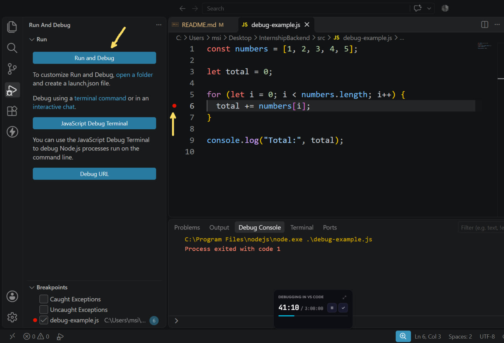
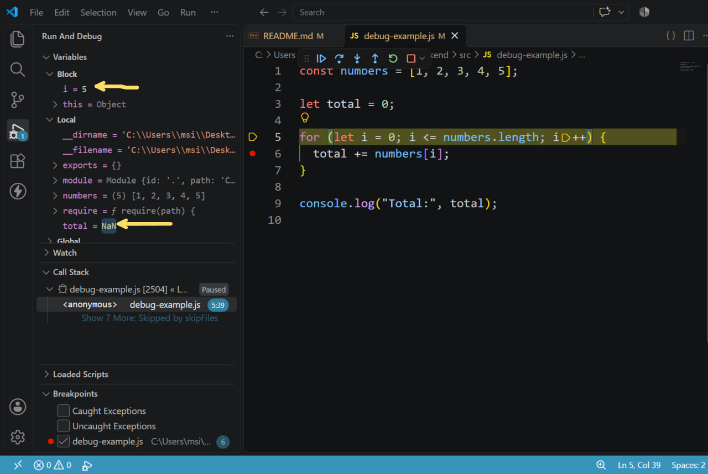
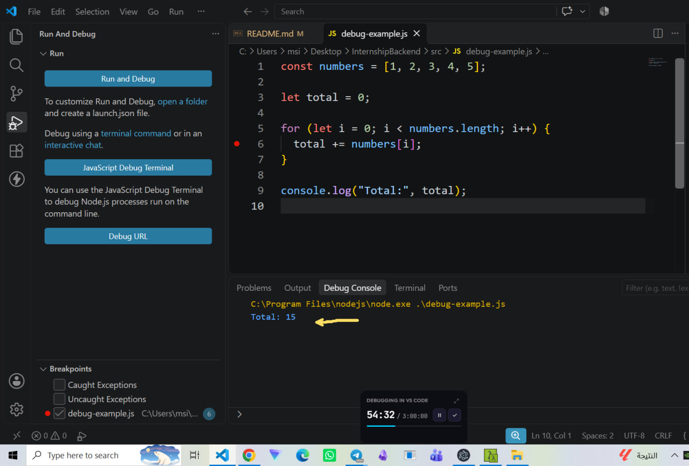

## التمرين الخامس: اكتشاف الأخطاء باستخدام VS Code Debugger

### الهدف من التمرين

بالبداية الهدف من هذا التمرين هو كتابة كود JavaScript يحتوي على خطأ داخل حلقة تكرارية ، ثم اكتشاف الخطأ وإصلاحه باستخدام (Debugger) في Visual Studio Code.

### وصف الخطأ

قمت بانشاء ملف باسم `src/debug-example.js` يحتوي على مصفوفة من الأرقام، وحلقة تكرار لحساب مجموع عناصرها.

كان شرط الحلقة في البداية:

```javascript
i <= numbers.length;
```

أدى هذا الشرط إلى تنفيذ الحلقة مرة إضافية، حيث وصلت قيمة `i` إلى `5`، بينما آخر فهرس (Index) موجود في المصفوفة هو `4`.

مما أدى إلى تحوّل قيمة المجموع إلى `NaN` (Not a Number).

```
total=NAN
```

### خطوات اكتشاف الخطأ

1. فتحت ملف `src/debug-example.js` في Visual Studio Code.
2. وضعت نقطة توقف (Breakpoint) على السطر الذي يجمع عناصر المصفوفة.



3. شغّلت البرنامج باستخدام Debugger من خلال المفتاح `F5`.
4. استخدمت `F10` (Step Over) لتنفيذ الكود خطوة بخطوة.
5. راقبت قيم المتغيرات `i` و`total` من لوحة Variables.
6. لاحظت أن قيمة `total` أصبحت `NAN` عندما وصلت قيمة `i` إلى `5`.

 7. حددت أن سبب الخطأ هو استخدام `<=` بدلًا من `<` في شرط الحلقة.

### إصلاح الخطأ

قمت بتعديل شرط الحلقة من:

```javascript
i <= numbers.length;
```

إلى:

```javascript
i < numbers.length;
```

وبذلك أصبحت الحلقة تتوقف قبل الوصول إلى فهرس غير موجود في المصفوفة.

بعد تشغيل البرنامج مرة أخرى، أصبح الناتج الصحيح:

```text
Total: 15
```

<!--  -->



### النتيجة

ساعدني استخدام Breakpoint وتنفيذ الكود خطوة بخطوة على تحديد مكان الخطأ وفهم سببه.

كما تعلمت كيفية مراقبة قيم المتغيرات واستخدام أدوات Debugger في Visual Studio Code لاكتشاف الأخطاء المنطقية وإصلاحها.
